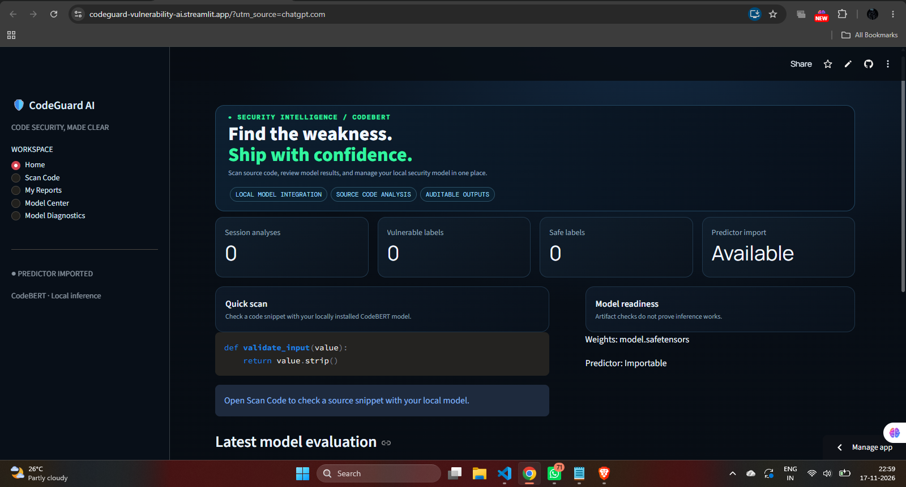
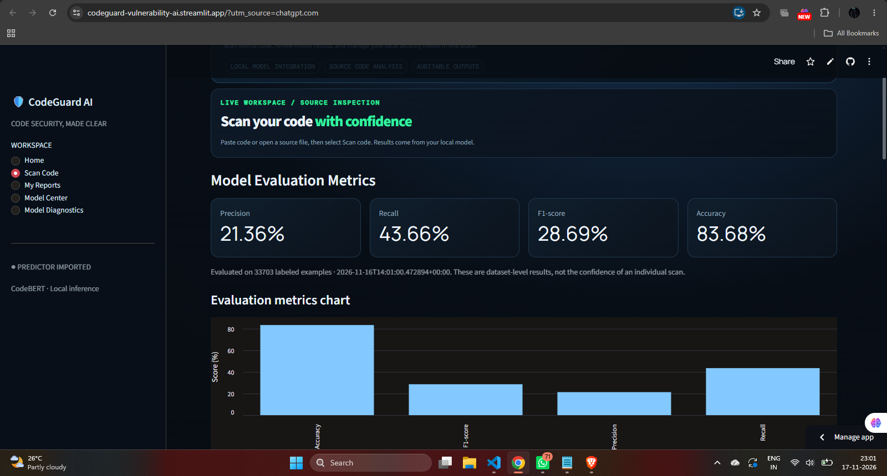
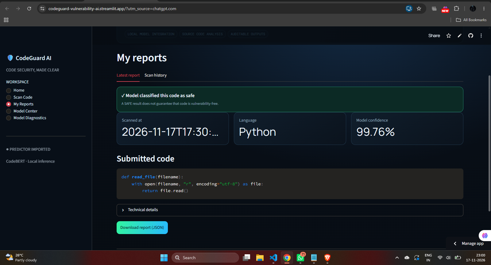
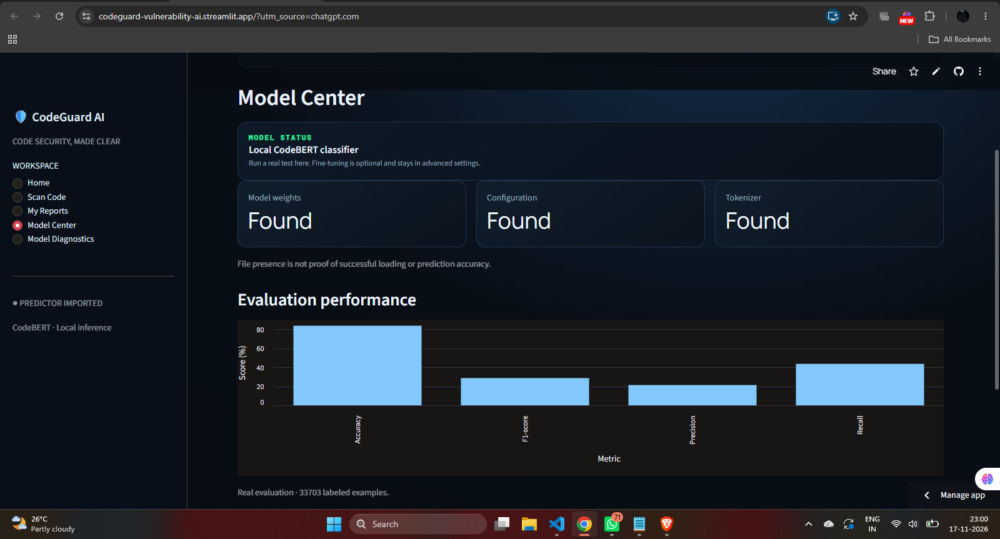

# 🛡️ CodeGuard AI
### AI-Powered Multilingual Source Code Vulnerability Detection

CodeGuard AI is a machine learning project that uses a fine-tuned CodeBERT model to analyze source code and classify it as potentially vulnerable or non-vulnerable.

The application provides an interactive interface where users can submit code snippets, view prediction results, check model evaluation metrics, and access scan reports.

The main goal of this project is to explore how transformer-based models can be applied to source code security analysis.

🌐 **Live Demo:** [Try CodeGuard AI](https://codeguard-vulnerability-ai.streamlit.app/)

🤗 **Hugging Face Model:** [CodeGuard Multilingual CodeBERT](https://huggingface.co/hemu10-08/CodeGuard-Multilingual-CodeBERT)

---

## 📸 Application Screenshots

### 1. Home Page

The main dashboard provides access to the different workspaces, predictor status, and quick scanning functionality.



### 2. Scan Code

The code scanning workspace allows users to submit source code for vulnerability classification and view model evaluation metrics.



### 3. My Reports

Users can view scan results, submitted code, model confidence, technical details, and download reports in JSON format.



### 4. Model Center

Displays model artifact availability and model evaluation performance through visual metrics.



---

## ✨ Features

- **Source Code Analysis:** Classifies submitted source code as potentially vulnerable or non-vulnerable.
- **Multilingual Support:** Designed for Python, Java, JavaScript, C, C++, and C#.
- **Transformer-Based Model:** Uses a fine-tuned CodeBERT architecture.
- **Prediction Confidence:** Displays model confidence and vulnerability probability.
- **Scan Reports:** Provides access to scan results and submitted code.
- **JSON Export:** Allows users to download scan reports.
- **Model Center:** Displays model artifact status and evaluation metrics.
- **Model Diagnostics:** Provides model-related diagnostic information.
- **Cloud Deployment:** Accessible through a Streamlit web application.

---

## 🧰 Technology Stack

| Category | Technologies |
|---|---|
| Programming Language | Python |
| Machine Learning | PyTorch |
| Model Architecture | CodeBERT |
| NLP / Transformers | Hugging Face Transformers |
| Web Application | Streamlit |
| Data Processing | Pandas, NumPy |
| Model Evaluation | Scikit-learn |
| Model Hosting | Hugging Face |
| Deployment | Streamlit Community Cloud |
| Version Control | Git, GitHub |

---

## 🧠 Model Information

- **Base Model:** `microsoft/codebert-base`
- **Model Name:** CodeGuard Multilingual CodeBERT
- **Task:** Binary source-code vulnerability classification
- **Classes:** Vulnerable and Non-Vulnerable
- **Maximum Input Length:** 512 tokens
- **Dataset:** MVD (Multilingual Vulnerability Detection)

The trained model is hosted on Hugging Face. The application automatically downloads the required model files when they are not already available locally.

**Model repository:**  
https://huggingface.co/hemu10-08/CodeGuard-Multilingual-CodeBERT

---

## 📊 Dataset Information

The project uses the MVD multilingual vulnerability dataset for model training and evaluation.

### Supported Programming Languages

- C / C++
- Java
- JavaScript
- Python
- C#

### Dataset Preparation

The dataset preparation process included:

1. Source-code data cleaning and preprocessing.
2. Duplicate and conflicting-record analysis.
3. Label and language distribution analysis.
4. Training, validation, and testing split preparation.
5. Dataset checks before model training.

### Dataset Distribution

| Dataset Split | Number of Samples |
|---|---:|
| Training | 155,619 |
| Validation | 33,147 |
| Testing | 33,703 |
| **Total** | **222,469** |

The test split was kept separate from model training and used for held-out evaluation.

---

## 📈 Model Evaluation

The model was evaluated using 33,703 held-out test samples.

| Evaluation Metric | Score |
|---|---:|
| Accuracy | 83.68% |
| Precision | 21.36% |
| Recall | 43.66% |
| F1-score | 28.69% |

These metrics represent the model's performance on the evaluation dataset. They should not be interpreted as a guarantee that an individual prediction is correct.

---

## ⚠️ Limitations

This project is an experimental machine learning application, and it has some limitations:

- Predictions may include false positives and false negatives.
- Detection performance varies between programming languages.
- Code longer than 512 tokens may be truncated.
- The model does not currently identify the exact vulnerable line of code.
- Dataset labels may contain inaccuracies or noise.
- Model predictions should not be treated as definitive security assessments.

CodeGuard AI is intended for educational and research purposes. It should not replace professional security audits, static analysis tools, or manual code reviews.

---

## 🚀 Installation and Setup

### 1. Clone the repository

```bash
git clone https://github.com/hemu10-08/CodeGuard-AI.git
```

```bash
cd CodeGuard-AI
```

### 2. Create a virtual environment

```bash
python -m venv .venv
```

### 3. Activate the environment

For Windows PowerShell:

```powershell
.\.venv\Scripts\Activate.ps1
```

### 4. Install dependencies

```bash
python -m pip install -r requirements.txt
```

### 5. Run the application

```bash
python -m streamlit run app.py
```

The application will open in your browser at the local URL displayed in the terminal.

**Note:** The trained model weights are hosted on Hugging Face and are automatically downloaded by the application when required. A separate manual model upload is not necessary.

---

## 📁 Project Structure

```text
CodeGuard-AI/
│
├── app.py
├── requirements.txt
├── README.md
├── .gitignore
│
├── .streamlit/
│   └── config.toml
│
├── assets/
│   ├── home.png
│   ├── scan-code.png
│   ├── my-reports.png
│   └── model-center.png
│
├── results/
│   └── model_metrics.json
│
└── src/
    ├── model.py
    └── multilingual_model.py
```

The trained model weights and datasets are hosted or stored separately and are not included in this GitHub repository.

---

## 🔗 Project Links

- **GitHub Repository:** https://github.com/hemu10-08/CodeGuard-AI
- **Live Application:** https://codeguard-vulnerability-ai.streamlit.app/
- **Hugging Face Model:** https://huggingface.co/hemu10-08/CodeGuard-Multilingual-CodeBERT

---

## 👨‍💻 About the Project

CodeGuard AI was developed as a hands-on project to explore the use of transformer-based machine learning models in source code security analysis.

Through this project, I worked on dataset preprocessing, CodeBERT fine-tuning, model evaluation, Python development, and web application deployment.

The project helped me gain practical experience in machine learning, NLP, model deployment, and building an end-to-end AI application.

---

**Developed by Hemachandran Nandakumar**
